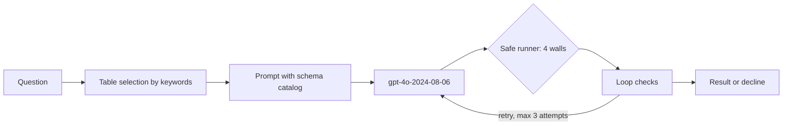

# Evaluated Text-to-SQL for German Electricity Data (SMARD)

Ask a question in English or German (app in progress), an LLM writes PostgreSQL, the query runs behind safety checks, and every result is measured against a fixed exam.

## At a glance

- Exam of 84 questions in 5 tiers. Best setup, r3b_safe: **60.00 / 84 strict (71.4%)** and **67.67 / 84 answer score (80.6%)**. The exam is a development set; the held-out result is pending.
- Strong on tiers 0 and 1 (strict 95.8% and 97.1%, answer score 95.8% and 100.0%). Weak on tiers 3 and 4 (strict 19.4% and 0.0%, answer score 52.8% and 41.7%).
- Four safety walls in front of every query, checked by 183 offline tests.
- Every run writes a manifest with prompt and file hashes.
- Status: evaluation pipeline done, Streamlit app in progress.

## Example

**Question** (exam item t2_02, tier 2): *Rank all sources by total output in July 2025.*
The best setup (r3b_safe) answered this correctly in 3 of 3 runs. SQL it wrote in run 1 ([results/r3b_safe_run1_2026-11-06.jsonl](results/r3b_safe_run1_2026-11-06.jsonl)):

```sql
SELECT energietraeger, SUM(mwh) AS total_output
FROM erzeugung
WHERE zeitpunkt >= '2025-07-01' AND zeitpunkt < '2025-08-01'
GROUP BY energietraeger
ORDER BY total_output DESC NULLS LAST;
```

Result (first 4 of 12 rows, from running that SQL on the database):

| energietraeger | total_output (MWh) |
|---|---:|
| Photovoltaik | 9,056,373.39 |
| Wind Onshore | 6,167,801.12 |
| Braunkohle | 5,754,061.25 |
| Erdgas | 2,927,114.00 |

> **"No data" case (u_08).** *How much wind did we generate in July 2026?* The data ends on 2026-06-01. The model wrote a normal query for July 2026 and it returned only NULL. The system checked the tables, found no rows for that period in any of them, and stopped without asking the model again:
> `NO_QUERY: No data: the tables have no rows for the period 2026-07-01 to 2026-07-31.`
> This was the result in 3 of 3 runs, with one model call each ([results/r3b_safe_run1_2026-11-06.jsonl](results/r3b_safe_run1_2026-11-06.jsonl), and runs 2 and 3).

> **Blocked query (from the safe-runner tests).** A delete hidden in a `WITH`:
> `WITH x AS (DELETE FROM preise RETURNING *) SELECT * FROM x`
> Blocked at wall 1, before the database is touched: `Delete is not allowed (read-only SELECT queries only)` ([grader/tests/test_safe_runner.py](grader/tests/test_safe_runner.py)).

## Why this project

The point is not that an LLM can write SQL. The point is to measure, with a fixed exam and repeated runs, which changes to the system actually help. Each change was added alone and run three times. Changes that did not help are kept in the results and listed below, including one note in the prompt that cost 11 points.

## Results (development exam)

Best setup: **r3b_safe**, the v2b prompt plus an execute-check-refine loop plus the safe runner. Model `gpt-4o-2024-08-06`, temperature 0, mean of 3 runs. Source: [results/answer_score_regrade_v2_2026-11-14.md](results/answer_score_regrade_v2_2026-11-14.md) (row r3b_safe).

| Tier | Questions | Strict score | Answer score |
|---|---:|---:|---:|
| 0 (unanswerable, must decline) | 8 | 7.67 (95.8%) | 7.67 (95.8%) |
| 1 (one aggregate) | 35 | 34.00 (97.1%) | 35.00 (100.0%) |
| 2 (grouping, ranking, shares) | 25 | 16.00 (64.0%) | 17.00 (68.0%) |
| 3 (dates, comparisons, sub-queries) | 12 | 2.33 (19.4%) | 6.33 (52.8%) |
| 4 (window functions, joins) | 4 | 0.00 (0.0%) | 1.67 (41.7%) |
| **All** | **84** | **60.00 (71.4%)** | **67.67 (80.6%)** |

Percentages are the mean divided by the tier size. Strict: the result must match the gold result exactly. Answer: the required answer columns must be present with the right values (see [How it is measured](#how-it-is-measured)).

The exam was used during development. The held-out result for the final setup is pending; the starting point for v2b on the 30 held-out questions was 19.33 / 30 ([PROJECT_PROGRESS.md](PROJECT_PROGRESS.md), section 8, Step N). Run-to-run noise is about 2 to 4 points per run ([PROJECT_PROGRESS.md](PROJECT_PROGRESS.md), section 8, Step C).

## What helped and what didn't

Mean of 3 runs out of 84, temperature 0. Sources: strict from [PROJECT_PROGRESS.md](PROJECT_PROGRESS.md) section 14, answer score from [results/answer_score_regrade_v2_2026-11-14.md](results/answer_score_regrade_v2_2026-11-14.md). "-" means no per-question file exists, so it was not re-graded.

| Row | Strict | Answer | What changed |
|---|---:|---:|---|
| naive | 46.0 | - | table and column names only |
| schema-linked | 46.7 | - | catalog with notes on data quirks (first run: 35, see findings) |
| + decline option | 55.33 | 58.00 | the model may answer `NO_QUERY: <reason>` |
| + v2a | 59.67 | 64.00 | Kernenergie note reworded |
| + v2b | 60.67 | 65.67 | descriptions for `metrik` and `preiszone` |
| v2b_fresh | 60.00 | 66.33 | same prompt, re-run with model logging; base for the loop rows |
| + R1 error retry | 59.33 | 67.00 | SQL error goes back to the model |
| + R2 empty retry | 59.67 | 67.67 | empty result goes back to the model |
| + R3 decline review | 59.67 | 66.00 | false "no data" declines are checked against the tables |
| + R3b system decline | 61.67 | 68.00 | proven-empty period: decline without a model call |
| + safe runner (r3b_safe) | 60.00 | 67.67 | four walls in front of every query; 0 queries blocked |
| *dropped:* v2c | 57.00 | 60.67 | date range in the prompt: false declines |
| *dropped:* v2b2 | 58.67 | 64.67 | "countries" wording: no gain |
| *dropped:* ex-a | 59.33 | 61.33 | 8 fixed examples: 35 wrong declines |
| *dropped:* ex-b | 56.33 | 57.00 | 3 retrieved examples: 51 wrong declines |
| *dropped:* df | 52.00 | 58.00 | narrower decline rule: 30 false declines |

R3b and r3b_safe differ by -1.67 on the strict score, which is within run-to-run noise: no query was blocked in the 3 runs ([results/analysis_r3b_safe_vs_r3b_2026-11-06.md](results/analysis_r3b_safe_vs_r3b_2026-11-06.md)).

**Findings**
- **One wrong note cost 11 points.** A catalog note said "multiply by 4 to get MW". The model did so on almost every question and scored 35 instead of 46 ([DECISIONS.md D18](DECISIONS.md#d18-the-mwhmw-catalog-note-was-reworded-after-it-caused-an-11-point-drop)).
- **The decline option fixed tier 0.** Unanswerable questions went from 0 of 8 to 7 of 8 in every run ([D22](DECISIONS.md#d22-decline-option-added-on-top-of-schema-linked)).
- **Examples fixed answer shape but caused false declines.** With ex-b, shape failures fell from 40 to 13, but the model declined 51 answerable questions ([PROJECT_PROGRESS.md](PROJECT_PROGRESS.md) section 14).
- **The strict score hid real fixes.** A second score that checks only the columns a question asks for (required columns written blind to agent results, [D42](DECISIONS.md#d42-answer-correctness-score-next-to-the-strict-score), [D43](DECISIONS.md#d43-second-external-review-plan-for-the-finish)) shows the error retry lifting tier 4 from 0 to about 2 of 4 (v2b_fresh 0.00; R1 and R2 2.00; R3 to r3b_safe 1.33 to 1.67). v2b_fresh had 6 crashed answers in 3 runs; r3b_safe had none ([results/analysis_r3b_safe_vs_r3b_2026-11-06.md](results/analysis_r3b_safe_vs_r3b_2026-11-06.md)). Tier 4 has only 4 questions.
- **The system decline fixed the "no data" question without a model call.** u_08 passes 3 of 3 (R3 asked the model again and it answered `SELECT 0`) ([D39](DECISIONS.md#d39-system-decline-for-proven-empty-periods-row-r3b-kept)).

## How it works



Keywords in the question pick which tables go into the prompt; if none or several match, all three tables are shown. The prompt carries a catalog with notes on the data quirks, and the model replies with one SELECT or with `NO_QUERY: <reason>`. Every query goes through the safe runner. A blocked query counts like an SQL error. The loop then applies four checks, with at most 3 attempts per question: error retry (the PostgreSQL error goes back to the model), empty retry (an empty result goes back), decline review (a "no data for period X" decline is checked against the tables), and system decline (a query for a period that has no rows in any table is declined without another model call). Code: [grader/agent_loop.py](grader/agent_loop.py), [grader/safe_runner.py](grader/safe_runner.py), [grader/date_facts.py](grader/date_facts.py).

## Safety

| Wall | What it does | What it blocks |
|---|---|---|
| 1. Static check (sqlglot) | Reads the SQL before the database is touched | More than one statement; anything but a SELECT; writes or admin commands anywhere, including inside a `WITH`; any table other than `erzeugung`, `verbrauch`, `preise` (so `pg_catalog` and `information_schema`); queries that read no table; functions such as `pg_sleep`, `pg_read_file`, `lo_*`, `dblink*`, `set_config`, `current_setting` |
| 2. Cost limit | `EXPLAIN (FORMAT JSON)` without running the query | Estimated cost above 15,533,613.4 (20 times the most expensive gold query) |
| 3. Read-only run | Read-only transaction as a SELECT-only database role, 30 s timeout, row cap read with `fetchmany` | A timeout; more than 20,000 rows |
| 4. Structured result | Every block returns `blocked`, `wall` and `reason` instead of raising | Nothing further; the loop reads the reason |

Limits: [grader/limits.yaml](grader/limits.yaml). Tests: 44 in [grader/tests/test_safe_runner.py](grader/tests/test_safe_runner.py) (22 attack tests for wall 1, 2 for allowed shapes, 11 for walls 2 and 3, 9 for the loop switch). On the 76 gold queries all pass the walls. Run on the saved history (2,910 agent queries), 5 would be blocked and none of them was a passing answer ([results/safe_runner_dryrun_2026-11-06.md](results/safe_runner_dryrun_2026-11-06.md)). These are tested safeguards, not a proof that any SQL is safe.

## How it is measured

- **The exam:** 84 questions in 5 tiers (8, 35, 25, 12, 4), in [gold_set_smard.yaml](gold_set_smard.yaml). It stores the correct SQL, not the correct answer, so it stays right when the data is reloaded. 76 questions have gold SQL; the 8 tier-0 questions must be declined ([PROJECT_PROGRESS.md](PROJECT_PROGRESS.md) section 5).
- **Runs:** 3 runs per row at temperature 0. The API is not fully deterministic, so the mean of 3 is reported.
- **Strict score:** the result must match the gold result exactly, including the number of columns ([D19](DECISIONS.md#d19-the-comparator-stays-strict-on-column-count-for-now)).
- **Answer score:** the result must contain the required answer columns (or one listed alternative) with the right values, rows and order; extra columns are allowed; columns are matched by values; made-up category labels must mean the gold label ([D42](DECISIONS.md#d42-answer-correctness-score-next-to-the-strict-score), [D43](DECISIONS.md#d43-second-external-review-plan-for-the-finish)). The required columns are in [grader/answer_columns.yaml](grader/answer_columns.yaml) and were written blind to agent results.
- **Held-out set:** 30 questions in [heldout_smard.yaml](heldout_smard.yaml), never used for tuning, checked for overlap with the exam by text and structure ([D29](DECISIONS.md#d29-held-out-set-of-30-questions-o13)).
- **Run manifests:** every run writes a receipt with the prompt hash of each question, the hash of the gold file, the git commit, model, settings and package versions ([D40](DECISIONS.md#d40-plan-change-after-an-external-review), [grader/README.md](grader/README.md)).

## Data

Source: SMARD.de, 2023-06-01 00:00 to 2026-06-01 23:45, one row per 15 minutes. Three tables in long format ([PROJECT_PROGRESS.md](PROJECT_PROGRESS.md) section 3):

| Table | Rows | Categories |
|---|---:|---|
| `erzeugung` (generation, MWh) | 1,263,744 | 12 energy sources |
| `verbrauch` (consumption, MWh) | 421,248 | 4 metrics |
| `preise` (day-ahead prices, EUR/MWh) | 1,790,304 | 17 price zones |

About 3.48 million rows in total. Quirks the system has to handle:
- Values are MWh per quarter-hour, not MW. Multiply by 4 for MW.
- Kernenergie is NULL, not zero, after 2024-01-30, so `ORDER BY ... DESC` needs `NULLS LAST`.
- The price zone `DE/AT/LU` exists but is empty; `∅ Anrainer DE/LU` is an average, not a country.
- `Pumpspeicher` means generation in `erzeugung` and pumping consumption in `verbrauch`.
- The tail is thin: June 2026 has one day and July 2026 has none.

## Limitations

- Tiers 3 and 4 are weak and small: 16 of the 84 questions. Under the strict score they pass 19.4% and 0.0%.
- The exam is a development set. The held-out result for the final setup is pending.
- Temperature 0 is not deterministic: attempt-1 replies differed in 106 of 252 question-runs between R3b and r3b_safe, which send the identical prompt ([results/analysis_r3b_safe_vs_r3b_2026-11-06.md](results/analysis_r3b_safe_vs_r3b_2026-11-06.md)).
- Daylight-saving duplicate timestamps (12 of 105,300) can multiply rows in joins on `zeitpunkt` (open item O15).
- An empty result can be a correct answer, so rewriting a query after an empty result can change the question (O16).
- The label keyword lists of the answer score were written blind and are not exhaustive; an unknown label fails.
- Only 7 of the 84 exam questions are in German, and most use the exact database words (open item O8), so German support is only lightly tested.
- There is no user-facing app yet.

## Setup

Needs Docker, Python 3.12 and, only for model runs, an OpenAI API key.

1. Create `.env` in the project root (it is in `.gitignore`) with these variables: `POSTGRES_USER`, `POSTGRES_PASSWORD`, `POSTGRES_DB`, `POSTGRES_PORT`, `POSTGRES_HOST` (all optional, defaults `app`, `app`, `smard`, `5432`, `localhost`), `GRADER_DB_USER` (the role name created by `sql/create_grader_role.sql`), `GRADER_DB_PASSWORD` (the password you choose for that role) and `OPENAI_API_KEY`.
2. Install the packages: `python -m venv .venv && source .venv/bin/activate && pip install -r requirements.txt`.
3. Download the three CSV files from the SMARD download center (https://www.smard.de/en/downloadcenter/download-market-data/): actual generation and wholesale prices with the website in German, actual consumption with the website in English; quarter-hour resolution, 01.06.2023 to 02.06.2026, CSV. Save them in `data/raw/` under the exact names listed in [docs/DATA.md](docs/DATA.md). Details and checks: [docs/DATA.md](docs/DATA.md).
4. Start the database and load the data:
   ```bash
   docker compose up -d
   cd scripts
   python load_data.py
   python load_verbrauch.py
   python load_preise.py
   ```
5. Create the read-only role (safe to re-run; feed the file in on stdin, a path after `-f` would be looked up inside the container):
   ```bash
   docker exec -i text-to-sql-db psql -U app -d smard -v grader_password="<GRADER_DB_PASSWORD>" < ../sql/create_grader_role.sql
   ```
6. Check the load (the expected counts are in the [Data](#data) table; the checks cover `erzeugung`):
   ```bash
   docker exec -i text-to-sql-db psql -U app -d smard < sanity_checks.sql
   ```
7. Run the offline tests (no API calls, they need the database and the role, and take a few minutes):
   ```bash
   cd ../grader
   python -m unittest discover -s tests
   ```
8. Run one row of the exam (about 84 or more API calls per run; the 3 runs of r3b_safe cost $0.57, see [the analysis](results/analysis_r3b_safe_vs_r3b_2026-11-06.md)):
   ```bash
   python run.py --config configs/r3b_safe.yaml
   ```
   Add `--runs 1` for a single run. Results and run receipts go to `results/`; see [grader/README.md](grader/README.md).

## Tech stack

- Python 3.12, standard `unittest` for the tests
- PostgreSQL 16 in Docker
- OpenAI API, model `gpt-4o-2024-08-06` pinned ([D36](DECISIONS.md#d36-model-pinned-to-the-dated-snapshot-gpt-4o-2024-08-06)); `text-embedding-3-small` only in the dropped ex-b row
- sqlglot (static SQL check and date finder), psycopg2, PyYAML, python-dotenv
- pandas (data loaders), scikit-learn (overlap check between exam and held-out set)

## Roadmap

Order from [D43](DECISIONS.md#d43-second-external-review-plan-for-the-finish):
1. Done: label matching in the answer score requires meaning.
2. This README.
3. Streamlit app: question, SQL, result, chart, short explanation, with honest "no rows match" and "no data" messages.
4. Langfuse tracing in the app.
5. Easy setup: `.env.example`, pinned packages, CI running the offline tests.
6. Freeze code and scoring, then the final held-out run.
7. Small user study (3 to 5 people, fixed tasks, completion and time).

Optional at the end: a LangGraph wrapper around the existing loop (checked against the equivalence tests), and UTC timestamps.

## Repository map

- [DECISIONS.md](DECISIONS.md): every decision with its reason and evidence (D1 to D43)
- [PROJECT_PROGRESS.md](PROJECT_PROGRESS.md): full state of the project, ablation table, open items
- [grader/README.md](grader/README.md): how to run a row, what the outputs are
- [docs/DATA.md](docs/DATA.md): where the SMARD CSV files come from and how to check them
- [grader/](grader/): grader, loop, safe runner, answer comparator, tests; [grader/configs/](grader/configs/) has one file per row
- [gold_set_smard.yaml](gold_set_smard.yaml), [heldout_smard.yaml](heldout_smard.yaml), [grader/answer_columns.yaml](grader/answer_columns.yaml): the exam, the held-out set, the answer columns
- [scripts/](scripts/) and [sql/](sql/): data loaders and the read-only role
- [results/](results/): all run logs and reports. Most useful:
  - [analysis_r3b_safe_vs_r3b_2026-11-06.md](results/analysis_r3b_safe_vs_r3b_2026-11-06.md): the best setup against its base
  - [answer_score_regrade_v2_2026-11-14.md](results/answer_score_regrade_v2_2026-11-14.md): strict and answer score for every saved row
  - [safe_runner_dryrun_2026-11-06.md](results/safe_runner_dryrun_2026-11-06.md): the safe runner on 2,910 saved queries
  - [analysis_r3b_vs_r3_2026-11-05.md](results/analysis_r3b_vs_r3_2026-11-05.md): the system decline

Data source: Bundesnetzagentur | SMARD.de
